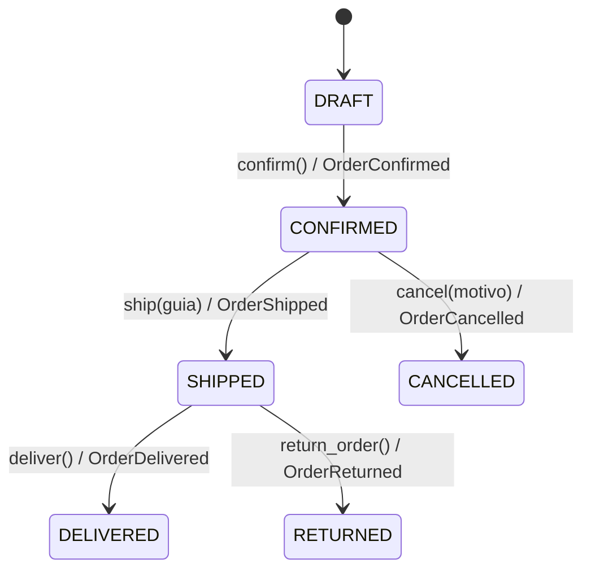

# Diagrama de estados de Order

```
DRAFT --confirm--> CONFIRMED --ship--> SHIPPED --deliver--> DELIVERED
                       |                  |
                    cancel             return
                       |                  |
                   CANCELLED           RETURNED
```



| Transición | Precondiciones | Evento |
|---|---|---|
| DRAFT -> CONFIRMED | con artículos y cliente activo | OrderConfirmed |
| CONFIRMED -> SHIPPED | guía no vacía | OrderShipped |
| CONFIRMED -> CANCELLED | motivo no vacío | OrderCancelled |
| SHIPPED -> DELIVERED | ninguna | OrderDelivered |
| SHIPPED -> RETURNED | ninguna | OrderReturned |

**Transiciones inválidas** (lanzan `InvalidOrderTransition`): confirmar dos veces
(confirm desde CONFIRMED), cancelar desde SHIPPED, entregar o devolver desde CONFIRMED
y confirmar un pedido CANCELLED. Los estados finales (DELIVERED, CANCELLED, RETURNED)
no admiten más operaciones.

**Domain Events.** Son objetos inmutables (`DomainEvent`: nombre, `order_id` y `occurred_at`).
Se registran en `order.events` solo al final de una transición exitosa: primero se valida,
luego se cambia el estado y por último se anota el evento. Una operación rechazada no
cambia el estado ni deja eventos (lo comprueba `test_confirmacion_doble_no_agrega_evento`).
